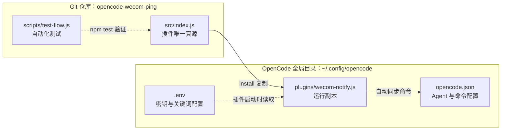

# 🔔 opencode-wecom-ping

> 兼容 OpenCode V2 插件 API，并保留 OpenCode V1 `server()` 入口用于过渡。

OpenCode 插件：当对话出现新状态时，通过**企业微信群机器人**实时推送到手机微信。

**默认静默**，只有切换到通知 Agent 或执行开启命令后，本会话才推送通知。关键词识别默认关闭，可按需配置开启。

## ✨ 三种启用方式

| 入口 | 方式 | 说明 |
|---|---|---|
| ① 指定 Agent | 切换到 `wecom-notify` agent | 该 agent 下的会话自动启用通知 |
| ② 斜杠命令 | 输入 `/wecom-notify` | 在当前会话开启通知（含 `$ARGUMENTS` 任务描述） |
| ③ 对话关键词 | 命中配置的关键词 | 默认关闭；设置 `WECOM_NOTIFY_KEYWORDS_ENABLED=true` 后启用 |

随时输入 `/wecom-off` 可关闭当前会话通知。手动关闭后，Agent 和关键词均不会自动重启通知；再次输入 `/wecom-notify` 才会恢复。

启用后推送的事件：

| 触发事件 | 推送内容 |
|---|---|
| `session.idle`（回复完成） | 会话标题 + 最后一条回复摘要 |
| `session.error`（会话出错） | 会话标题 + 错误信息 |
| `permission.asked`（需要权限确认） | 会话标题 + 权限请求描述 |

> ⚠️ `permission.updated` 不是 OpenCode 的有效事件（仅存在于生成类型残留中），实际有效事件为 `permission.asked` / `permission.replied`。本插件监听 `permission.asked`。

## ✨ 特性

- 🚫 默认静默：关键词识别默认关闭，避免业务对话误触发
- 🔕 手动启停：使用 `/wecom-notify` 开启、`/wecom-off` 关闭当前会话通知
- 🚫 内置去重：同一轮回复只通知一次，避免 ralph-loop / ebuilder 等自动循环刷屏
- 📦 零依赖：仅使用 Node/Bun 原生 `fetch`
- 🔐 密钥不硬编码：通过环境变量或 `.env` 文件注入，可安全公开仓库

## 🚀 安装

OpenCode 的插件机制**原生支持本地路径**，无需 `npm install`。以下方式任选其一。

### 方式一：全局安装（本地开发推荐）

将仓库中的 `src/index.js` 作为唯一真源，安装到 OpenCode 全局插件目录。不要直接修改安装后的副本，否则下次升级会覆盖且仓库无法记录改动。

安装后的目录关系如下：



`src/index.js` 与 `plugins/wecom-notify.js` 应保持完全一致；`.env` 保存本机配置，不复制进 Git 仓库。

Linux / macOS：

```bash
git clone https://github.com/VastFuture/opencode-wecom-ping.git
cd opencode-wecom-ping
npm test
mkdir -p ~/.config/opencode/plugins
install -m 644 src/index.js ~/.config/opencode/plugins/wecom-notify.js
cmp -s src/index.js ~/.config/opencode/plugins/wecom-notify.js
```

命令全部成功即表示源码测试通过，且安装副本与仓库真源完全一致。然后完全退出并重启 OpenCode；插件启动时会自动注册 `wecom-notify` Agent，并将 `/wecom-notify`、`/wecom-off` 同步到 `~/.config/opencode/opencode.json`。

升级时在同一仓库执行：

```bash
git pull --ff-only
npm test
mkdir -p ~/.config/opencode/plugins
install -m 644 src/index.js ~/.config/opencode/plugins/wecom-notify.js
cmp -s src/index.js ~/.config/opencode/plugins/wecom-notify.js
```

升级完成后同样需要完全退出并重启 OpenCode。重启后确认 Agent 切换器中存在 `wecom-notify`，并确认 `/wecom-notify` 和 `/wecom-off` 可用；满足这两项才算安装完成。

> 五种安装方式只能选择一种。不要同时通过自动发现目录、`plugin` 数组或 npm 加载插件，也不要同时安装全局版和项目版，否则会创建多个插件实例，造成重复通知或会话状态不一致。

### 方式二：项目级

将 `src/index.js` 放入项目 `.opencode/plugins/wecom-notify.js`。

### 方式三：通过本地路径引用（无需复制）

在 `opencode.json` 的 `plugin` 数组中直接写本地路径，支持相对路径、绝对路径和 `file://` URL：

```json
{
  "$schema": "https://opencode.ai/config.json",
  "plugin": ["./opencode-wecom-ping/src/index.js"]
}
```

或使用绝对路径（Windows，请替换为你自己的路径）：

```json
{
  "$schema": "https://opencode.ai/config.json",
  "plugin": ["C:/your-path/opencode-wecom-ping/src/index.js"]
}
```

> 💡 `file:` / `.` 开头 / 绝对路径均被识别为本地路径插件，加载时直接读取源码，**不会**走 npm 安装。
> ⚠️ 绝对路径会暴露你的本地目录结构，若在意隐私，推荐用**方式一（复制到全局插件目录）**或下面的相对路径。

### 方式四：npm 包

```json
{
  "$schema": "https://opencode.ai/config.json",
  "plugin": ["opencode-wecom-ping"]
}
```

```bash
npm install -g opencode-wecom-ping
```

### 方式五：GitHub Release 资产（无需 npm 登录）

每次发布都会同时上传一个 tarball 到 GitHub Releases，可直接从 URL 安装，**不依赖 npm 账号/token**：

```bash
npm install https://github.com/FountainChan/opencode-wecom-ping/releases/download/v1.0.2/opencode-wecom-ping-1.0.2.tar.gz
```

将 URL 中的版本号 `v1.0.2` 替换为最新发布版本即可（见 [Releases 页面](https://github.com/FountainChan/opencode-wecom-ping/releases)）。

> 💡 npm registry 与 GitHub Release 双通道发布：安装方式可随时切换，GitHub 通道不受 npm token 有效期影响。

## ⚙️ 配置

### 0. wecom-notify Agent（入口①）

插件会通过 `config` hook 自动注册 `wecom-notify` primary agent，无需手工添加。安装或升级插件后必须**完全退出并重启 OpenCode**，运行中的实例不会热加载新 Agent。

如需指定模型或覆盖提示词，可在 `opencode.json` 中只写需要覆盖的字段：

```json
{
  "$schema": "https://opencode.ai/config.json",
  "agent": {
    "wecom-notify": {
      "model": "你的-provider/你的-model",
      "description": "自定义描述"
    }
  }
}
```

### 1. 创建企业微信群机器人

手机端企业微信 → 创建一个群（哪怕只有自己）→ 群设置 → 群机器人 → 添加机器人，复制 Webhook 地址中的 `key`。

### 2. 注入密钥（三选一）

**a) 环境变量（推荐用于 shell 会话）**

```bash
export WECOM_BOT_KEY="你的群机器人key"
```

**b) `.env` 文件**

推荐在 OpenCode 全局配置目录创建 `~/.config/opencode/.env`：

```bash
WECOM_BOT_KEY=你的群机器人key
```

也支持在**工作目录**（运行 OpenCode 的目录）或**插件所在目录**创建 `.env`。

优先级：环境变量 > `~/.config/opencode/.env` > 工作目录 `.env` > 插件目录 `.env`。

**c) 系统级配置**（Windows）

在「系统属性 → 高级 → 环境变量」中添加用户变量 `WECOM_BOT_KEY`。

> 🔒 密钥查找顺序固定为上述优先级，任一命中即生效；全未命中则静默跳过推送。

### 3. 配置关键词识别（可选）

关键词识别默认关闭。需要使用时，在环境变量或上述任一 `.env` 文件中配置：

```bash
WECOM_NOTIFY_KEYWORDS_ENABLED=true
WECOM_NOTIFY_KEYWORDS=微信,wecom,wecom-notify
```

- `WECOM_NOTIFY_KEYWORDS_ENABLED`：只有值为 `true`（不区分大小写）时才启用。
- `WECOM_NOTIFY_KEYWORDS`：使用英文逗号分隔；配置后会替换内置默认关键词。
- 未配置 `WECOM_NOTIFY_KEYWORDS` 时，默认关键词为 `微信,wecom,wecom-notify`。
- 修改环境变量或 `.env` 后，应完全退出并重启 OpenCode。

## 🔧 工作原理

```
用户消息 → chat.message hook
             ├─ /wecom-off                            → 关闭并静音本会话
             ├─ /wecom-notify                         → 解除静音并启用本会话
             ├─ 已静音                                → 保持关闭
             ├─ input.agent === "wecom-notify"        → 启用本会话
             └─ 关键词开关已开启且命中配置关键词       → 启用本会话
                               │
                 enabled.add(sessionID)（会话内持续生效，无需每次开启）
                               │
server 事件 → event hook（仅启用过的会话）
             ├─ session.idle       → 推送 ✅ 回复完成
             ├─ session.error      → 推送 ⚠️ 会话出错
             └─ permission.asked   → 推送 🔔 需要权限确认
```

- 门控状态为**会话级**：启用后，该会话后续相关事件都会推送，直到执行 `/wecom-off` 或 OpenCode 插件实例结束。
- `/wecom-off` 优先于 Agent 和关键词入口；只有 `/wecom-notify` 可以解除手动静音。
- 去重：`session.idle` 按「最后一条 assistant 消息 id」去重，同一回复只通知一次，避免 ralph-loop / ebuilder 自动循环刷屏。

## 🧪 本地验证

**1. 真实发送测试**（会真的发一条到群）：

```bash
node scripts/send-test.js "测试消息"
```

> Windows 终端直接 `curl` 发送中文可能乱码（GBK 编码问题），本脚本使用 Node `fetch`（UTF-8）规避，请用它验证。

**2. 链路自动化测试**（不真实发送，拦截 fetch）：

```bash
npm test
# 或
node scripts/test-flow.js
```

覆盖 Agent 自动注册与用户覆盖、完整密钥优先级、手动启停、默认关闭的关键词识别、自定义关键词、静音优先级、同轮去重、`session.error`、`permission.asked`、无效事件 `permission.updated` 忽略、缺失 sessionID 静默等。

## 💡 兼容性说明

- **CLI / TUI / 桌面版均可用**：`session.idle`、`session.error`、`permission.asked` 是 OpenCode **server 层**统一发布的事件（见 `packages/schema/src/session-status-event.ts`、`packages/schema/src/v1/permission.ts`），与前端界面无关。桌面版用 `session.idle` 弹系统通知，CLI 下它同样触发——本插件正是补上 CLI 无通知 UI 的短板。
- **`session.idle` 已标记 deprecated**（新事件为 `session.status`，含 `status.type: "idle"`），但官方**仍持续发布**它（桌面通知、ralph-loop 自动续写等均依赖它），因此当前可放心监听。
- **`permission.updated` 不是有效事件**（仅存在于生成类型 `types.gen.ts` 的残留），有效事件为 `permission.asked`（AI 请求权限）与 `permission.replied`（用户已回复）。本插件只监听 `permission.asked`。

## 📱 通知内容示例

```
[opencode] ✅ 回复完成
会话：重构购物车模块
- 完成 CheckoutService 拆分
- 新增 12 个单元测试，全部通过
...
```

```
[opencode] 🔔 需要权限确认
会话：数据分析任务
Bash(git push --force)
```

## 🚀 发布新版本

发布流程由 GitHub Actions 自动完成，开发者只需两步：

```bash
# 1. 修改 package.json 中的 version（如 1.0.2 → 1.0.3）
# 2. 提交并打 tag（tag 名 = v + 版本号）
git commit -am "chore: bump 1.0.3"
git push origin main
git tag v1.0.3
git push origin v1.0.3
```

推送 tag 后，workflow 会自动依次执行：

1. **运行测试**（`npm test`，失败则中断）
2. **检查 NPM_TOKEN 过期时间**（剩余 <14 天警告；<7 天或已过期则阻断发布并提示更新）
3. **发布到 npm registry**（`npm publish`）
4. **打包并上传 GitHub Release 资产**（`opencode-wecom-ping-<版本>.tar.gz`）

发布产物双通道：

| 通道 | 地址 | 依赖 |
|---|---|---|
| npm registry | `npm install opencode-wecom-ping` | npm token（有效期最长 90 天，需定期更新） |
| GitHub Release | `npm install https://github.com/FountainChan/opencode-wecom-ping/releases/download/v1.0.2/opencode-wecom-ping-1.0.2.tar.gz` | 无（GitHub Actions 自动上传） |

> ⚠️ npm 自 2026-02-03 起强制 granular token 最长 90 天有效期，无法创建长期 token。发布前 workflow 的过期检查会提前提醒；即使 token 失效，GitHub Release 通道仍可正常安装。

## 📄 License

MIT
